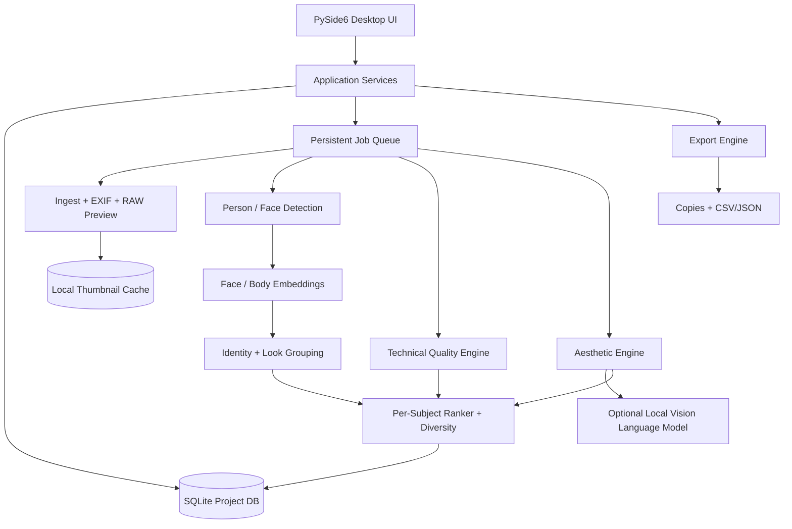
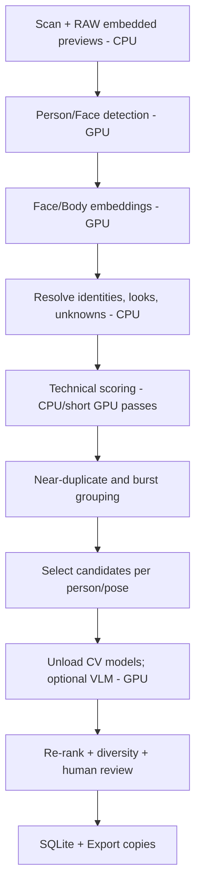

# SNORLU AI CULLING — ĐẶC TẢ KỸ THUẬT (SRS/Architecture/Implementation Plan)

**Phiên bản:** 1.1 — 26/10/2026  
**Máy đích (profile đã chốt):** Intel Core i7-10750H · NVIDIA RTX 2080 Super Max-Q 8GB · RAM 32GB  
**Nền tảng:** Windows 10/11 x64  
**Mô hình triển khai:** 100% offline (không gửi ảnh, metadata, embedding hoặc suy luận lên cloud)  
**Trạng thái:** Bản thiết kế giao cho AI coding agent; các chỉ tiêu đánh giá là mục tiêu nghiệm thu đề xuất, chưa phải kết quả kiểm thử thực tế.

## 1. Mục tiêu và phạm vi

### 1.1. Bài toán
Người chụp ảnh cosplay/street thường mang về 500–5.000 file RAW/JPEG sau một buổi chụp. Ứng dụng cần tự tìm những người/chủ thể xuất hiện trong bộ ảnh; gom ảnh cùng một người hoặc cùng một *look* (người + trang phục/nhân vật + phiên chụp); đánh giá chất lượng kỹ thuật, bố cục, màu sắc và nét nghệ thuật; và đề xuất bộ ảnh đẹp, đa dạng cho **từng chủ thể**, có giải thích và cho phép người dùng quyết định cuối cùng.

### 1.2. Phạm vi V1
- Windows desktop offline; nhập thư mục đệ quy, hỗ trợ JPG/JPEG, PNG, TIFF, RAW theo định dạng LibRaw đang hỗ trợ (đặc biệt ARW, CR2/CR3, NEF, RAF, DNG nếu codec thực tế xử lý được).
- Preview và contact sheet nhanh dựa trên ảnh nhúng trong RAW; có cơ chế fallback; zoom kiểm tra nét bằng dữ liệu đủ độ phân giải.
- Phát hiện người, khuôn mặt, tạo embedding, gom cụm theo **person identity** và **look/session**; cho phép người dùng sửa cụm.
- Nhiều người trong một ảnh: một ảnh có nhiều subject-occurrences; hiển thị trong từng nhóm tương ứng; chấm điểm theo từng người.
- Chấm 7 tiêu chí, xếp hạng Best Shot theo burst/pose, tránh đề xuất ảnh trùng lặp; giải thích dựa trên bằng chứng.
- Xuất lựa chọn sang thư mục, CSV/JSON; giữ nguyên file gốc, cặp RAW+JPG.
- Mọi phiên phân tích có thể pause/resume; cache; thay đổi trọng số không cần chạy lại bước nhận diện.

### 1.3. Ngoài phạm vi V1
- Chỉnh sửa ảnh như Lightroom/Photoshop; chỉnh sửa RAW không phá hủy chuyên sâu.
- Tìm danh tính thật, tra cứu Internet, hoặc nhận diện một người lạ từ nguồn ngoài bộ ảnh.
- Nhận diện chính xác tuyệt đối khi bị che mặt, trang phục đồng nhất, người quá nhỏ hoặc ảnh chuyển động mạnh.
- Tự xóa ảnh gốc; tự đồng bộ cloud; tự gắn thẻ/mô tả nhạy cảm về con người.
- Huấn luyện mô hình nền từ đầu hoặc cam kết xác định chính xác mức 'đẹp' một cách khách quan.

## 2. Nguyên tắc sản phẩm
1. **Offline-by-design:** Không cần API key, mạng, đăng nhập, telemetry hoặc cuộc gọi tới cloud. Trọng số và giấy phép đi kèm gói cài đặt; không `from_pretrained()` tự tải khi dùng.
2. **Non-destructive:** Mặc định đọc gốc; không ghi vào RAW/JPEG, không tự xóa/đổi tên/di chuyển gốc. Mọi thao tác xuất bản sao phải có xác nhận và xử lý va chạm tên file.
3. **Human-in-the-loop:** Phân cụm và chấm điểm có độ tin cậy; nhóm không chắc được đưa vào *Review*, không tự gộp/tách mạnh tay.
4. **Subject-aware:** Tách điểm theo chủ thể và điểm tổng thể ảnh; ảnh nhiều người có thể có điểm riêng cho từng người.
5. **Style-aware:** Bối cảnh cosplay/street/portrait thay đổi cách áp dụng các tiêu chí, tránh phạt motion blur/ánh sáng tạo hình có chủ đích.
6. **Auditable:** Lưu điểm thành phần, mô hình, phiên bản, quy tắc, lý do đề xuất, chỉnh sửa của người dùng.

## 3. User stories và yêu cầu chức năng

| ID | Yêu cầu | Độ ưu tiên | Tiêu chí chấp nhận |
|---|---|---|---|
| FR-01 | Import folder lớn | P0 | Quét ảnh, tránh trùng file, xử lý đường dẫn Unicode và có progress |
| FR-02 | RAW/JPEG preview | P0 | Grid, preview, zoom 100%; fallback khi RAW không có preview |
| FR-03 | Subject detection | P0 | Xác định 0..N người và khuôn mặt trên một ảnh |
| FR-04 | Auto subject grouping | P0 | Tạo Subject 001, 002... và Look A/B; nhóm không chắc chuyển Review |
| FR-05 | Manual merge/split | P0 | Gộp/tách/đổi tên; lưu sửa đổi và không tự ghi đè khi reprocess |
| FR-06 | Technical analysis | P0 | Độ nét chủ thể, ánh sáng, màu sắc, clip sáng/tối, phát hiện lỗi |
| FR-07 | Aesthetic analysis | P0 | Bố cục, góc máy, pose/biểu cảm có thể quan sát, giá trị thị giác |
| FR-08 | Per-subject scoring | P0 | Một ảnh nhiều người lưu điểm riêng từng người |
| FR-09 | Best-shot selection | P0 | Nhóm chuỗi giống nhau; chọn ảnh tốt nhất + dự phòng; đa dạng pose |
| FR-10 | Explainability | P0 | Hiển thị rubric, vùng nhận xét, độ tin cậy, cảnh báo |
| FR-11 | Manual culling | P0 | Keep, Reject, Favorite, 1–5 sao, lọc và phím tắt |
| FR-12 | Export | P0 | Copy selected giữ cấu trúc hoặc theo subject, CSV/JSON, RAW+JPEG |
| FR-13 | Pause/resume and cache | P0 | Có thể tắt ứng dụng và mở lại dự án không cần xử lý lại bước xong |
| FR-14 | Style presets | P1 | Cosplay, Street, Portrait, Custom; đổi preset chỉ rerank nếu đủ cache |
| FR-15 | Local VLM comment | P1 | Nhận xét top-N ứng viên offline, không ảnh hưởng chạy bản nhẹ |
| FR-16 | Preference learning | P2 | Ghi cặp người dùng chọn/loại; học ranker cá nhân sau khi có dữ liệu |
| FR-17 | XMP sidecars | P2 | Ghi riêng .xmp có xác nhận; tương thích phần mềm hậu kỳ cần nghiệm thu |

## 4. Kiến trúc module



### 4.1. Giao diện và quản lý dự án
- **UI:** PySide6/Qt Widgets, dark mode, giao diện ba cột: cây nhóm chủ thể, grid ảnh, inspector bên phải; filmstrip/compare khi mở preview.
- **Application services:** event bus signals/slots; thực hiện tác vụ dài ở worker processes hoặc thread phù hợp; UI tuyệt đối không chạy inferencing trực tiếp.
- **Jobs:** pipeline idempotent từng asset/stage; hàng đợi bền vững trong SQLite, retry, cancel/pause, batch size và giới hạn RAM/VRAM.
- **Cache:** thumbnails, resized previews, crops, embeddings; versioned, bounded disk quota, có nút clear cache.

### 4.2. Ingest và ảnh RAW
1. Đọc tên, kích thước, EXIF, orientation, chụp lúc nào, camera/lens và định danh file; nhận diện cặp RAW+JPEG từ thư mục + basename + timestamp thay vì chỉ tên.
2. RAW -> embedded JPEG preview nếu có, else demosaic theo yêu cầu; lưu độ phân giải preview, orientation và color space; quản lý ICC/sRGB tránh sai màu.
3. Preview dùng cho quét và AI lần một. Khi kiểm tra sắc nét/top ảnh, crop tại độ phân giải thích hợp từ RAW hoặc JPEG đầy đủ; thumbnail không đủ để kết luận focus.
4. Nhập ảnh không đồng nghĩa copy; lưu đường dẫn tham chiếu; file đổi vị trí phải có tính năng relink.

### 4.3. Subject detection & identification
- **Detector:** mô hình person detection nhẹ dạng ONNX, ví dụ lựa chọn từ OpenCV Zoo (kiểm tra license cho từng file/weight).
- **Face detector:** OpenCV YuNet (MIT cho model directory) + **face embedding:** OpenCV SFace (Apache-2.0 cho model directory).
- **Body/person re-ID:** OSNet/Torchreid hoặc mô hình embeddings tương đương; bổ sung đặc trưng DINOv2 trên crop, chú ý sự khác nhau giữa *same outfit* và *same person*.
- **Clustering:** đánh giá cặp dựa trên cosine similarity khuôn mặt khi có mặt rõ, body embedding, trang phục, thời gian chụp và chuỗi burst. Không dùng một ngưỡng cố định chung cho tất cả điều kiện.
- **Cannot-link constraint:** Hai người xuất hiện độc lập đồng thời trong cùng ảnh không được bị gộp thành một danh tính (trừ lỗi detector được đánh dấu).
- **Must-link manual:** người dùng xác nhận hai nhóm là cùng người => lưu ràng buộc qua lần chạy lại.
- **Confidence:** High -> auto group; Medium -> Suggested merge; Low -> Unknown/Review. Ngưỡng được hiệu chỉnh trên ảnh thực tế và lưu config; không công bố là độ chính xác xác suất nếu chưa hiệu chuẩn.
- **Hai cấp nhóm:** (A) *Person Identity*: cùng một cá nhân qua nhiều trang phục; (B) *Look/Session*: cá nhân + trang phục/nhân vật + phiên chụp. Người dùng có thể sắp xếp theo cả hai.
- **Không gắn danh tính thật tự động:** Subject 001, 002...; người dùng chủ động đặt tên.

### 4.4. Chấm điểm quality theo từng chủ thể
Rubric đề xuất (tổng 100, có thể chỉnh):

| Tiêu chí | Trọng số | Tín hiệu | Cảnh báo giới hạn |
|---|---:|---|---|
| Độ nét chủ thể | 20 | Focus trên mắt/khuôn mặt, cấu trúc vải/tóc, motion blur | Cần kiểm tra đủ resolution, không chỉ preview |
| Ánh sáng | 15 | Exposure phân vùng chủ thể, highlight/shadow, backlight | Không phạt low-key/stage light có chủ đích |
| Màu sắc | 15 | White balance, skin/costume consistency, palette harmony | Tránh áp chuẩn trung tính cho ánh sáng nghệ thuật |
| Bố cục | 20 | Vị trí chủ thể, crop, negative space, distracting background | Tùy portrait/full-body/street |
| Góc chụp | 10 | Phối cảnh, đường dẫn, chiều sâu, méo hình | Đánh giá góc sáng tạo theo ý đồ |
| Pose/khoảnh khắc | 10 | Che khuất, mắt nhắm, pose, khoảnh khắc quan sát được | Không suy luận trạng thái tâm lý hoặc thuộc tính nhạy cảm |
| Tính nghệ thuật tổng thể | 10 | Aesthetic model + VLM nhận xét có kiểm chứng | Điểm thẩm mỹ mang tính chủ quan |

**Mô hình hóa:** Lưu vector điểm 0..100 và `confidence` theo từng `(image_id, subject_occurrence_id, model_version, profile_version)`. Chỉ chuẩn hóa sang `final_score` nếu đủ tiêu chí hợp lệ; tiêu chí không quan sát được gắn `N/A` rồi phân phối lại trọng số và hạ confidence, không tự cho điểm 0. Điểm từng ảnh không đồng nhất với điểm một chủ thể trong ảnh nhiều người.

**Quy tắc cảnh báo:** highlight bị clip trên mặt, mắt nhắm, focus miss rõ ràng hoặc cắt tay/chân bất lợi => cờ *Review*, không xóa tự động và không luôn luôn chặn ảnh nghệ thuật.

### 4.5. Aesthetic AI chạy offline
- **Bước 1:** các phép đo nhẹ OpenCV + hình học bbox/mask, vùng mặt, rule-based composition và image embedding.
- **Bước 2:** aesthetic predictor (ví dụ LAION aesthetic predictor trên CLIP features) là một tín hiệu bổ sung, không đủ làm chuẩn chân lý; cần bộ ảnh người dùng đánh giá để hiệu chỉnh riêng cho cosplay/street.
- **Bước 3 tùy phần cứng:** VLM nhỏ lưu hoàn toàn cục bộ (ví dụ Qwen3-VL-2B-Instruct, Apache-2.0), chỉ xem *shortlist*; yêu cầu trả JSON ngắn gồm: `composition_note`, `lighting_note`, `subject_note`, `strengths`, `weaknesses`, `uncertainty`. Cấm VLM tự dựng số đo focus/luminance; những giá trị định lượng phải lấy từ Technical Engine.
- Không tải model tại runtime; đóng gói tokenizer/config/weights, tắt Hub/download fallback; không chạy server trên giao diện mạng. Nếu dùng llama.cpp, chỉ bind localhost và tránh bắt buộc server.
- Có thể tắt VLM mà pipeline cốt lõi vẫn hoạt động.

### 4.6. Chọn Best Shot và tính đa dạng
1. Phân nhóm `burst` theo thời gian, tương đồng scene, face/body pose và pHash/embeddings; liên tiếp thời gian chỉ là gợi ý, không phải điều kiện duy nhất.
2. Trong mỗi burst/look, rank theo `final_score`, ưu tiên chủ thể cần chọn; chọn Top-1 và runner-up dự phòng.
3. Ở bước tạo album cuối, sử dụng tiêu chí đa dạng: khác pose, góc máy, cỡ cảnh (close-up/half-body/full-body), hậu cảnh và thời điểm. Có thể triển khai MMR: `utility = lambda * quality - (1-lambda) * max_similarity_to_already_selected` sau khi chuẩn hóa cùng thang. MMR là thuật toán hậu xử lý **không thay đổi điểm chất lượng gốc**.
4. Có tùy chọn **Top N ảnh/người**, **Top K% mỗi người**, **1 ảnh mỗi burst**, **giữ cả ảnh nhóm**.
5. Không để nhóm có nhiều ảnh lấn át hoàn toàn nhóm ít ảnh; chọn theo từng subject rồi mới tổng hợp.

## 5. Data model đề xuất (SQLite)
- `projects(id, name, root_path, created_at, preset, config_json)`
- `assets(id, relative_path, size, mtime, optional_sha256, media_type, orientation, exif_json, pair_group_id, status)`
- `asset_previews(asset_id, thumb_path, preview_path, width, height, render_version)`
- `subjects(id, project_id, display_name, user_locked, created_at)`
- `looks(id, subject_id, label, session_id)`
- `occurrences(id, asset_id, subject_id NULL, look_id NULL, bbox, face_bbox, confidence, crop_path)`
- `embeddings(occurrence_id, encoder_id, encoder_version, vector_blob_or_path)`
- `cluster_constraints(id, left_occurrence_id, right_occurrence_id, type, source)`
- `bursts(id, project_id, time_range, scene_key)`; `burst_members(burst_id, asset_id)`
- `quality_scores(asset_id, occurrence_id NULL, profile_id, model_version, scores_json, confidences_json, flags_json, composite_score)`
- `recommendations(subject_id, asset_id, occurrence_id, burst_id, rank, reason_json, run_id)`
- `decisions(asset_id, subject_id NULL, keep_reject, rating, favorite, manual_override, updated_at)`
- `jobs(id, project_id, stage, state, progress, error, model_version)`
- `model_registry(model_id, version, checksum, license, provenance, enabled)`

Khóa dữ liệu nên phân biệt ảnh **thực thể** (`assets`) và **lần xuất hiện của chủ thể** (`occurrences`). Đây là điều kiện để chấm điểm riêng từng người và một ảnh thuộc nhiều album.

## 6. Giao diện UX tối thiểu
- **Library View:** bên trái nhóm chủ thể + số ảnh; giữa contact sheet; phải thông số/AI score; thanh trên Import, Analyze, Filter, Export.
- **Subject View:** avatar crop, tên do người dùng đặt, các *looks*, Top Picks, Bursts, Needs Review; kéo thả/gộp/tách nhóm.
- **Compare View:** 2–4 ảnh cùng burst; zoom đồng bộ tới 100%, pan đồng bộ, mặt/mắt highlight, score breakdown và phím chọn.
- **Review Unknown:** so sánh gợi ý gộp nhóm với bằng chứng mặt/trang phục và nút Confirm/Reject.
- **Settings:** profile chấm điểm, trọng số, GPU/CPU, giới hạn VRAM, cache quota, bật/tắt VLM, output policy.
- **Phím tắt đề xuất:** ←/→ điều hướng, `K` Keep, `X` Reject, `1..5` sao, `C` compare, `F` favorite, Space preview. Cho phép người dùng thay đổi.

## 7. Yêu cầu phi chức năng

### 7.1. Offline và bảo mật
- Khởi động + toàn bộ workflow trong điều kiện ngắt Internet; kiểm thử bằng firewall deny-outbound. Không có API clients, analytics SDK, crash upload hay cơ chế tự tải weights.
- Cơ sở dữ liệu/cache lưu trong `%LOCALAPPDATA%` hoặc thư mục dự án do người dùng chọn; dễ xóa khi hoàn thành.
- Face embeddings là dữ liệu đặc trưng sinh trắc nhạy cảm; lưu local, không chia sẻ, mã hóa khi cần; chế độ bỏ qua face recognition nếu người dùng muốn.
- Không tạo file công khai tên thật; không dò người ngoài thư viện; chỉ nhận diện bằng nhóm nội bộ do người dùng nhập.
- Tất cả thao tác export phải chống path traversal, symlink loop, overwrite im lặng và mất cặp RAW+JPEG.

### 7.2. Hiệu năng
- Mục tiêu ban đầu: import >= 1.000 ảnh hỗn hợp trong một dự án; UI không treo khi AI chạy; timeline và progress chính xác.
- Đặt benchmark thực tế theo 3 tier phần cứng: CPU-only, GPU phổ thông, GPU khá; **không cam kết** thời gian xử lý 1.000 ảnh trước khi đo.
- Batching, resized inference và candidate-only VLM; chạy quality full-resolution chỉ trên candidate hoặc khi cần.
- Cache theo `(file fingerprint, model version, preprocess version, rubric version)`; thay đổi trọng số không được chạy lại detector.
- Worker crashes: job checkpoint và retry có giới hạn; errors ở một file không dừng dự án.

### 7.3. Cấu hình máy tính
- **Lite CPU-only:** RAM 16 GB, SSD; xử lý không VLM hoặc VLM rất chậm.
- **Đề xuất:** RAM 32 GB, SSD, NVIDIA RTX với >=8 GB VRAM cho bước AI nâng cao; chưa phải điều kiện bắt buộc.
- **Tăng cường:** GPU 12 GB VRAM trở lên cho VLM và batch lớn; Intel/AMD hỗ trợ qua ONNX/CPU nếu model tương thích đã test.
- CUDA/PyTorch cho NVIDIA; ONNX Runtime CPU dự phòng. DirectML/Windows ML là hướng hỗ trợ đa GPU, cần benchmark và test riêng vì khả năng tương thích operator khác nhau.

### 7.4. Đóng gói
- `PyInstaller --onedir` cho MVP, tách ứng dụng và thư mục `models/`, cài đặt bằng Inno Setup (hoặc hệ thống installer tương đương).
- Có `model-manifest.json` kèm SHA-256, model card, license, version, kích thước; self-check trước khi inference.
- Không phụ thuộc Python đã cài trên máy khách; không cần tải bộ model lần đầu mở ứng dụng.

## 8. Chính sách giấy phép kỹ thuật
- **PySide6:** LGPLv3/GPL/commercial; kiểm tra nghĩa vụ phân phối Qt và thư viện động nếu đóng mã nguồn.
- **OpenCV YuNet:** directory MIT; **SFace:** directory Apache-2.0; kiểm tra chính xác từng weight tải về.
- **DINOv2:** Apache-2.0 theo model card; **SAM 2:** Apache-2.0, nhưng không bắt buộc trong V1.
- **OSNet weights:** repo model card trên Hugging Face ghi MIT; đối chiếu nguồn xuất xứ và notices khi phát hành.
- **LAION aesthetic predictor:** repository MIT; xác minh license của CLIP backbone và trọng số đi kèm.
- **Qwen3-VL-2B-Instruct:** model card Apache-2.0; dùng bản chính thức hoặc bản quant hóa có provenance/license rõ ràng.
- **LƯU Ý:** `pyiqa/IQA-PyTorch` hiện có **PolyForm Noncommercial License 1.0.0**, do đó **không mặc định đưa vào sản phẩm thương mại**. Có thể dùng nghiên cứu khi phù hợp điều kiện nhưng phải thay thế trước khi phân phối thương mại nếu không có quyền sử dụng.
- Mọi phụ thuộc phải có SBOM và bảng model/weight provenance; rà soát giấy phép độc lập trước khi phát hành, không suy diễn quyền thương mại chỉ từ license mã nguồn.

## 9. Các mốc triển khai đề xuất (không phải cam kết thời gian)

| Sprint/mốc | Phạm vi thực hiện | Definition of Done |
|---|---|---|
| M0 — Feasibility/Spike | Benchmark RAW, GPU, license, chọn model từ bộ ảnh mẫu | Có báo cáo benchmark, matrix giấy phép, baseline; quyết định stack |
| M1 — Desktop Foundation | Qt UI, ingest, cache, RAW preview, SQLite, phím tắt | Duyệt 1.000 ảnh không đứng UI, persist ratings, relink |
| M2 — Subject Intelligence | Detector, face/body embedding, 2 cấp nhóm, unknown review | Đạt chỉ tiêu identity grouping trên bộ test được gắn nhãn |
| M3 — Quality/Artistic Scoring | Region-aware metrics, rubric, profiles, score breakdown | Điểm từng occurrence, test ngoại lệ cosplay/street |
| M4 — Smart Selection | Burst grouping, Best Shot, diversity, manual override | Top-N/người không chỉ là ảnh trùng, so sánh 2–4 ảnh |
| M5 — Local VLM Optional | Local small VLM trên shortlisted images, JSON review | Tắt VLM vẫn dùng được; không mạng; không bịa số đo |
| M6 — Packaging/Release | Installer, GPU/CPU fallback, validation, regression | Fresh Windows PC + outbound-block test, không cần Python/network |

Khuyến nghị phát triển MVP với M0–M4 rồi mới thêm VLM. Không lập tức ghép 6–8 mô hình nặng vào bản đầu tiên.

## 10. Kế hoạch đánh giá và bộ dữ liệu nghiệm thu

### 10.1. Bộ thử nghiệm cần tự chuẩn bị
- **Dataset A — Portrait/Cosplay:** >=500 ảnh, >=5 người, đa dạng pose/đèn sân khấu, khuôn mặt rõ và khuôn mặt che.
- **Dataset B — Street:** >=300 ảnh, người nhỏ/đông người, motion blur chủ đích, ngược sáng.
- **Dataset C — Burst/Duplicates:** >=200 ảnh chụp liên tiếp, nhiều ảnh gần trùng và mắt nhắm/focus miss.
- **Dataset D — RAW/IO:** >=100 RAW nhiều máy và RAW+JPEG pairs, file hỏng, ảnh xoay, đường dẫn Unicode.
- Người chụp gắn nhãn ground-truth: chủ thể A/B/C, same-look, best-shot theo burst, Top-10/người, chấp nhận hoặc từ chối lý do AI.

### 10.2. Chỉ tiêu nghiệm thu *mục tiêu* (phải hiệu chỉnh sau M0)
- Không mất/đổi dữ liệu gốc: **100%** testcase ghi-đọc-non-destructive thành công.
- Crash-free import và resume trên bộ kiểm thử: **100%** testcase chuẩn.
- **Identity false-merge:** mục tiêu <=1% trên các nhóm AI tự gộp *high-confidence* có nhãn (ưu tiên độ chính xác hơn độ phủ; nhóm không chắc đưa Review).
- **Identity review recall:** mục tiêu >=95% ảnh có người được phân loại vào nhóm/Review thay vì bị mất dấu; ngưỡng tùy detector.
- **Top-5 agreement:** mục tiêu >=70% sự trùng khớp với ít nhất một nhiếp ảnh gia chấm trên tập so sánh thích hợp; phải xác định công thức thống nhất trước test, không xem là sự thật phổ quát.
- **Duplicate suppression:** >=90% burst có tối đa 1 lựa chọn chính khi bật chế độ 1/burst (trừ override).
- Điểm và cấu hình tái lập ổn định khi chạy lại cùng file/model/config; sai lệch do không quyết định được công bố.
- Kiểm thử offline: chặn outbound trước khi mở lần đầu, mọi pipeline vẫn chạy với model bundle hợp lệ.

### 10.3. Cách đo
- Grouping: pairwise precision/recall, false merges, fraction unknown, manual interventions/1000 ảnh.
- Ranking: pairwise preference accuracy, Recall@K hoặc NDCG@K trên đánh giá có người chấm.
- Diversity: số pose/góc/scene khác nhau trên Top N, duplicate rate.
- Performance: ingest time, AI time/image, peak RAM/VRAM, app cold start, UI frame responsiveness trên từng thiết bị.
- Trust: tỉ lệ người dùng phải đảo ngược quyết định và các ca đề xuất sai nghiêm trọng.

## 11. Những rủi ro cần giải quyết
1. **Cosplay che mặt / hai người cùng trang phục:** tự gộp sai; cần cannot-link, hai cấp nhóm và Review.
2. **RAW preview không phản ánh nét thật hoặc màu RAW:** dùng preview để phân loại nhanh, xem full-res khi cần; giữ thông tin ICC và điều kiện render.
3. **Aesthetic bias:** ảnh low-key, motion blur, street bị đánh giá thấp; cho preset và chế độ *artistic exception*.
4. **Multi-person photos:** scoring toàn ảnh không nói được ai đẹp; phải dùng occurrence-level scoring.
5. **GPU không tương thích/hết VRAM:** backend capability-check, batch size giảm, CPU fallback, optional VLM.
6. **Licensing:** sử dụng weights không rõ provenance/NC; bắt buộc `model-manifest` và review trước phát hành.
7. **Khả năng giải thích:** VLM có thể đưa nhận xét không đúng; ràng buộc vào tín hiệu tính toán và không coi VLM là thước đo kỹ thuật.

## 12. Cấu trúc repository đề xuất

```text
snorlu-ai-culling/
├─ app/
│  ├─ main.py
│  ├─ ui/                    # views, dialogs, viewmodels
│  ├─ core/                  # project, events, configuration
│  ├─ ingest/                # import, EXIF, RAW thumbnails
│  ├─ detection/             # person + face detection
│  ├─ identity/              # embeddings, clustering, review
│  ├─ quality/               # technical scores + evidence
│  ├─ aesthetics/            # local aesthetic + optional VLM
│  ├─ ranking/               # burst, score, diversity
│  ├─ export/                # files, CSV, JSON; optional XMP
│  ├─ storage/               # SQLite migrations/repos
│  └─ workers/               # pipeline, cancellation, resources
├─ models/                   # pretrained weight bundle (not necessarily in Git)
├─ configs/                  # presets, defaults, model manifest
├─ tests/
│  ├─ unit/
│  ├─ integration/
│  ├─ fixtures/
│  └─ acceptance/
├─ docs/
│  ├─ architecture.md
│  ├─ security-offline.md
│  ├─ evaluation-protocol.md
│  └─ model-licenses.md
├─ scripts/                  # local dev/setup/package
├─ pyproject.toml
├─ README.md
└─ LICENSES/
```

## 13. Ví dụ cấu hình cấu phần AI

```yaml
privacy:
  offline_only: true
  telemetry: false
  forbid_runtime_downloads: true
analysis:
  preset: cosplay
  enable_local_vlm: false
  high_confidence_auto_merge: true
  review_uncertain_clusters: true
  preserve_raw_jpeg_pairs: true
  max_parallel_workers: 2
ranking:
  top_n_per_subject: 15
  one_primary_per_burst: true
  diversity_lambda: 0.75
  weights:
    sharpness: 20
    lighting: 15
    color: 15
    composition: 20
    camera_angle: 10
    pose_moment: 10
    artistry: 10
export:
  mode: copy
  never_modify_originals: true
  include_csv: true
  include_json: true
```

**Lưu ý:** Các tùy chọn trên mô tả thiết kế, không phải file cấu hình đã chạy được.

## 14. Prompt handoff cho ChatGPT Codex / Claude Code

> You are the lead engineer for a production-oriented **100% offline, non-destructive Windows AI photo-culling desktop application**, named Snorlu AI Culling. Read this specification fully. Do not change fundamental architectural decisions without documenting the tradeoff. Implement the product in **small independently testable milestones**, starting with M0 feasibility and M1 native desktop foundation. The application must never send images, embeddings or metadata to a network service and must not download model weights at runtime. Prioritize RAW preview speed, project persistence, keyboard culling, subject grouping, per-subject scoring and evidence-based best-shot selection. Use PySide6, SQLite, Python, modular workers, ONNX/PyTorch backends as feasible, versioned models/cache, and GPU/CPU fallback. Never delete or modify originals. Every subject has a stable internal ID and a manual-merge/split workflow. A photo can belong to multiple subjects, each with their own quality score. Create real executable code, unit/integration tests, profiling harness, model license manifest, packaging scripts, and user documentation. Avoid fake implementations, simulated AI results or placeholder claims of accuracy. Run tests and report failures and limitations honestly. First output the detailed implementation plan for **M0 + M1**, then create the project skeleton and implement M1 end-to-end. Do not claim completion until the code has run and passed tests.

## 15. Các nguồn kỹ thuật cần đọc
- LibRaw: https://www.libraw.org/
- rawpy thumbnail: https://pypi.org/project/rawpy/
- Qt for Python: https://doc.qt.io/qtforpython-6/
- OpenCV Zoo YuNet: https://github.com/opencv/opencv_zoo/blob/main/models/face_detection_yunet/README.md
- OpenCV Zoo SFace: https://github.com/opencv/opencv_zoo/blob/main/models/face_recognition_sface/README.md
- Torchreid / OSNet: https://kaiyangzhou.github.io/deep-person-reid/
- DINOv2 model card: https://github.com/facebookresearch/dinov2/blob/main/MODEL_CARD.md
- LAION Aesthetic Predictor: https://github.com/LAION-AI/aesthetic-predictor
- Qwen3-VL-2B Instruct: https://huggingface.co/Qwen/Qwen3-VL-2B-Instruct
- ONNX Runtime Windows: https://onnxruntime.ai/docs/get-started/with-windows.html
- PyIQA commercial licensing caution: https://github.com/chaofengc/IQA-PyTorch

---
**Giới hạn hiện tại:** Đây là đặc tả và kế hoạch triển khai, **chưa phải ứng dụng đã được lập trình hoặc benchmark**. Khi có ảnh mẫu và cấu hình máy thật, M0 phải điều chỉnh lựa chọn models, độ chính xác kỳ vọng và hiệu năng trước khi chốt phiên bản đầu tiên.


## 16. Phụ lục bản 1.1 — Profile phần cứng thực tế và quyết định triển khai

### 16.1. Thông số máy đích

- **CPU:** Intel Core i7-10750H (6 cores / 12 threads), ưu tiên EXIF/RAW preview, các phép đo kỹ thuật, pipeline I/O và SQLite.
- **GPU:** NVIDIA GeForce RTX 2080 Super Max-Q (Turing / SM 7.5, 8 GB GDDR6). Dùng CUDA cho object detection, face/person embeddings, vision embeddings và các mô hình ONNX/PyTorch đã thử trên GPU này.
- **RAM:** 32 GB, cho phép buffer thumbnail, decode và cache nhưng phải có hạn mức tránh SWAP.
- **Lưu trữ:** chưa có thông tin dung lượng/SSD; thiết kế dùng cache có quota, khuyến cáo đặt cache trên SSD/NVMe nếu có.
- **Power/thermal:** GPU Max-Q bị giới hạn công suất và dễ phụ thuộc nhiệt/nguồn; tất cả benchmark phải đo khi cắm sạc và ghi nhiệt độ, công suất, trạng thái throttling.

**Kết luận:** đủ cho phiên bản offline với pipeline nhiều giai đoạn; không thiết kế việc chạy đồng thời nhiều mô hình thị giác nặng hoặc huấn luyện từ đầu. Không cam kết thông lượng trước khi benchmark trên máy thật.

### 16.2. Backend tương thích

1. Chạy `nvidia-smi`, kiểm tra driver, **VRAM trống thực tế**, compute capability (`sm_75`), temperature và phiên bản CUDA mà driver hỗ trợ.
2. Dùng **FP16** cho model GPU có hỗ trợ, FP32 khi gặp operator không tương thích; không bật `torch.bfloat16` mặc định vì Turing không có BF16 Tensor Core hỗ trợ theo cách Ampere trở lên.
3. Dùng một bộ thư viện **PyTorch và ONNX Runtime GPU được khóa phiên bản phù hợp** với driver/CUDA/cuDNN trên máy. CUDA 12.x/13.x có các phương án hỗ trợ SM75, nhưng không mặc định rằng bản `pip install` mới nhất luôn chạy; luôn kiểm tra `torch.cuda.get_device_capability()` và ONNX `CUDAExecutionProvider` bằng inference thật. ONNX GPU/cuDNN có ma trận tương thích riêng; không trộn tuỳ ý các major version.
4. Fallback sang CPU không mất tiến độ nếu CUDA out-of-memory hoặc model không tương thích; log chi tiết GPU/CPU mỗi job.
5. Đóng gói runtime DLL đúng phiên bản, test trên máy Windows mới ngắt mạng. Không yêu cầu người dùng cài Python.

### 16.3. Phân bố tài nguyên đề xuất (giá trị thiết kế khởi đầu, chưa benchmark)

| Stage | Thực hiện | Giá trị ban đầu | Ghi chú |
|---|---|---|---|
| Import/RAW preview | CPU + disk | 2-4 workers decode | Tối đa 2-4 RAW decode cùng lúc, không nạp cả thư mục vào RAM |
| Person + face detection | GPU/ONNX | batch 4, cạnh dài 960px | Có thể giảm 2 / 640px khi VRAM thấp |
| OSNet / DINOv2-Small | GPU/FP16 | batch 8, crop 224-256px | Lưu embedding vào SQLite/file cache, unload trước stage VLM |
| Scoring kỹ thuật | CPU, GPU tùy thuật toán | image preview 1200-1600px | Kiểm tra độ nét mắt/chủ thể trên crop gốc độ phân giải cao của Top candidates |
| Aesthetic predictor | GPU/FP16 | batch 8 | Chỉ là tín hiệu tương đối; hiệu chỉnh theo cosplay/street |
| Qwen3-VL-2B GGUF Q4 | llama.cpp local | 1 ảnh/yêu cầu; tối đa 768-1024px; context nhỏ | Chỉ trên shortlist; unload nhóm mô hình khác khỏi GPU; trả JSON ngắn |
| Cache | SSD nếu có | quota khởi đầu 20 GB, tùy chỉnh | Xóa/thu hồi an toàn theo LRU, không xóa gốc |

**VRAM policy:** ưu tiên giữ mức sử dụng ứng dụng khoảng **5,5-6,5 GB** khi đã trừ phần VRAM đang dùng bởi Windows/các app khác; giá trị này là *mục tiêu mềm*, luôn đo thực tế `free_vram` và điều chỉnh tự động. Dùng 1 GPU inference job nặng tại một thời điểm. Không giữ DINO + detector + VLM cùng tải trên GPU. Bộ nhớ thực tế của VLM gồm weights, visual projector, KV cache và workspace; size file GGUF không phải mức VRAM thực thi.

### 16.4. Model registry ưu tiên cho chiếc máy này

- **Face detection/embedding:** OpenCV YuNet + SFace ONNX. Thử tốc độ, chất lượng cosplay; kiểm tra mặt quay ngang và mặt che.
- **Person detector:** mô hình person ONNX lightweight có chứng cứ giấy phép hợp lệ, lựa chọn cuối ở M0 sau kiểm thử độ chính xác người nhỏ/trang phục cosplay.
- **Body Re-ID:** OSNet x0.25/x1.0, lựa chọn theo nhãn test. Không dùng body embedding như danh tính thật duy nhất; cần tách `same_person` khỏi `same_look`.
- **General visual embeddings:** DINOv2-small; tắt hoặc dùng chỉ trên ảnh khó nếu tốn thời gian không xứng hiệu quả.
- **Photo scoring:** OpenCV region-aware + mô hình aesthetic predictor nhẹ. Hạn chế chấm quá chắc về màu từ preview JPEG embedded có profile tùy camera.
- **Local Vision Language Model:** Qwen3-VL-2B-Instruct GGUF Q4 (model + mmproj tương thích) qua llama.cpp CUDA bản build chạy được trên Turing. Chỉ dùng cho Top candidates, không áp dụng trực tiếp làm thước đo focus. Nếu không qua test tốc độ/VRAM thì chuyển thành tính năng bật theo yêu cầu, không ảnh hưởng culling tự động.
- **Không đưa vào mặc định:** SAM2 full-resolution, VLM >=7B, hàng loạt VLM đồng thời, face models với trọng số cấm thương mại/không rõ provenance.

### 16.5. Pipeline thực thi chuẩn trên RTX 2080 Super Max-Q



- **Identity confidence** được tính từ nhiều tín hiệu, độ tin cậy thấp => Review; chủ thể cosplay đổi tóc/đồ không được tự khẳng định cùng người nếu chưa đủ dữ liệu.
- **RAW zoom:** preview nhúng chỉ để xem nhanh; nhận xét "nét vào mắt" phải kiểm chứng trên crop gốc hoặc bản render độ phân giải thích hợp.
- **Preset cosplay/street:** cùng scoring rubric nhưng ngưỡng ảnh bị blur/màu ánh sáng đổi theo style; chuyển preset chỉ tái xếp hạng khi tín hiệu cũ đã cache.
- **Ranking:** Top 1 per burst + backup, sau đó diversity reranking; một ảnh có nhiều người được tính vào nhiều album, mỗi người có điểm riêng.

### 16.6. Benchmark M0 (bắt buộc trước khi chọn bản release)

1. Chạy script kiểm tra hệ thống và lưu output không có thông tin riêng tư nhạy cảm: driver, compute capability, free GPU memory, Python, torch, onnxruntime, CUDNN.
2. Tập nhỏ: 100 RAW/JPEG, có ít nhất 3-5 chủ thể, ảnh nhóm, cosplay che mặt, ánh sáng đỏ-xanh và ảnh cố ý motion blur.
3. Tập trung bình: 500 ảnh. Tập lớn: 1.500 ảnh. Ghi **median/p95 thời gian mỗi stage**, peak VRAM, RAM, số ảnh lỗi, nhiệt độ GPU và số lần group nhầm/không chắc.
4. Người dùng chấm nhãn cho 50-100 cặp cùng burst: chọn tốt hơn, crop nét hơn, mầu đẹp hơn; ghi đồng thuận so với AI. Có mẫu ảnh RAW và JPEG gốc để kiểm tra preview khác ảnh render.
5. Xác định tốc độ/ngưỡng phù hợp rồi khóa model weights, preprocessing, provider và dependencies vào model manifest. Nếu VLM không đảm bảo hiệu năng, mặc định tắt và chỉ chạy khi người dùng bấm "Đánh giá sâu".

**Tiêu chí pass M0:** Không cần Internet; không chạy hết VRAM; GUI vẫn responsive; resume job; không sửa gốc; nhận diện chủ thể cao độ tin cậy không gộp nhầm trên test; các lựa chọn Top ảnh có thể được người chụp kiểm tra/đảo ngược.

### 16.7. Lệnh kiểm tra cho người dùng Windows

Trong PowerShell:

```powershell
nvidia-smi
python --version
python .\Snorlu_AI_Culling_diagnose_hardware.py
```

`diagnose_hardware.py` chỉ đọc và hiển thị thông số. Nếu chưa cài Python hoặc các thư viện AI, script vẫn hiển thị phần có sẵn và ghi rõ phần nào chưa kiểm tra được.

### 16.8. Nguồn tham khảo cập nhật phần cứng

- NVIDIA legacy/modern GPU compute capability: https://developer.nvidia.com/cuda/gpus/legacy
- NVIDIA GPU instruction support SM 7.5: https://docs.nvidia.com/cuda/cuda-compiler-driver-nvcc/
- ONNX Runtime CUDA/cuDNN compatibility: https://onnxruntime.ai/docs/execution-providers/CUDA-ExecutionProvider.html
- Qwen3-VL-2B GGUF local llama.cpp: https://huggingface.co/Qwen/Qwen3-VL-2B-Instruct-GGUF
- RTX 2080 Super Max-Q GPU specifications: https://www.notebookcheck.net/NVIDIA-GeForce-RTX-2080-Super-Max-Q-GPU-Benchmarks-and-Specs.459206.0.html

*Lưu ý: đây là một đặc tả thiết kế có hiệu chỉnh phần cứng, không phải bằng chứng đã đo kiểm trên máy của người dùng.*
